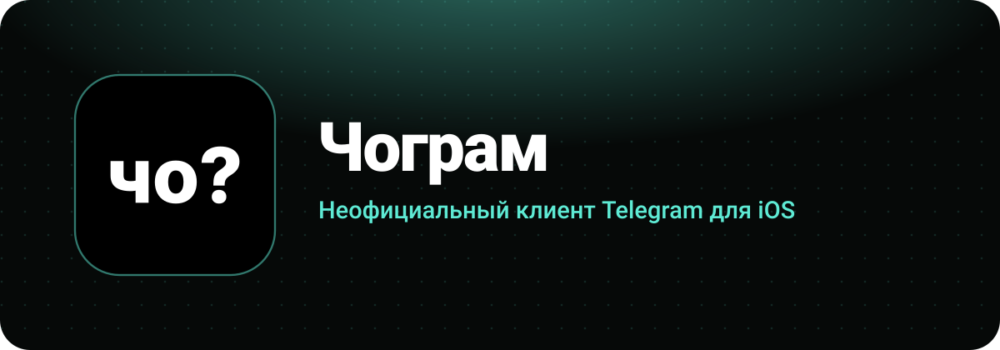

  

  <a href="https://github.com/nexxzaid/chogram/releases/latest"><b>Скачать последнюю сборку</b></a>
  &nbsp;·&nbsp;
  <a href="https://t.me/wabexe">Разработчик</a>

 

Чограм работает с твоим обычным аккаунтом Telegram и добавляет то, чего не хватает в официальном приложении. Это личный проект, а не сервис: никаких своих серверов для сообщений здесь нет, переписка идёт напрямую в Telegram.

 

<table>
<tr>
<td width="50%" valign="top">

 
**Удалённые остаются** 
Сообщение, которое удалил собеседник, сереет и остаётся в чате. Это видишь только ты. Работает и с автоудалением, и когда удаляют весь чат.

</td>
<td width="50%" valign="top">

 
**Режим призрака** 
Без онлайна, отметок о прочтении, просмотров историй и статуса «печатает». Включается одной кнопкой в списке чатов.

</td>
</tr>
<tr>
<td valign="top">

 
**Без рекламы** 
Спонсорские сообщения в каналах и реклама в поиске просто не загружаются.

</td>
<td valign="top">

 
**Сколько угодно аккаунтов** 
Вместо лимита на три аккаунта обычное меню Telegram, только без предела.

</td>
</tr>
<tr>
<td valign="top">

 
**Цитаты из голосовых** 
Текст расшифровки можно процитировать в ответе.

</td>
<td valign="top">

 
**Чистый текст** 
Фильтр убирает Zalgo, который расползается на соседние строки и ломает чат.

</td>
</tr>
</table>

 

<h3 align="center">Свой вид</h3>

  &nbsp;
  &nbsp;
  &nbsp;
  &nbsp;
  &nbsp;
  

  Шесть иконок приложения, форма аватарок от круга до квадрата, 
  стиль удалённых сообщений и свой значок рядом с ними.

 

## Установка

Сборки неподписанные, поэтому ставятся через [AltStore](https://altstore.io):

1. Скачай `Chogram.ipa` со [страницы релизов](https://github.com/nexxzaid/chogram/releases/latest).
2. В AltStore открой **My Apps**, нажми **+** и выбери файл.
3. С бесплатным Apple ID подпись живёт 7 дней, потом приложение надо обновить в AltStore.

Пуш-уведомлений нет: расширения отключены, а сертификат APNs при такой установке недоступен.

## Сборка

Сборку делает GitHub Actions, собственный Mac не нужен.

1. Сделай форк и получи `api_id` и `api_hash` на [my.telegram.org](https://my.telegram.org/apps).
2. Добавь их в секреты репозитория как `TELEGRAM_API_ID` и `TELEGRAM_API_HASH`.
3. Запушь в ветку `chogram`. Готовый `.ipa` появится в релизах.

Первая сборка занимает около часа. Настройка лежит в [`.github/workflows/chogram.yml`](.github/workflows/chogram.yml).

## Что важно знать

- Это **неофициальный клиент**, он не связан с Telegram и не поддерживается им.
- Часть функций нарушает условия использования Telegram API. Ответственность за свой аккаунт на тебе.
- Секретные чаты и одноразовые фото и видео намеренно не сохраняются.
- Удалённые сообщения хранятся только на твоём устройстве.

 

Откуда код

 

Чограм основан на [Telegram-iOS](https://github.com/TelegramMessenger/Telegram-iOS) и наследует условия его лицензии, поэтому исходный код открыт. Иконки интерфейса взяты из набора [Solar](https://github.com/480-Design/Solar-Icon-Set).

